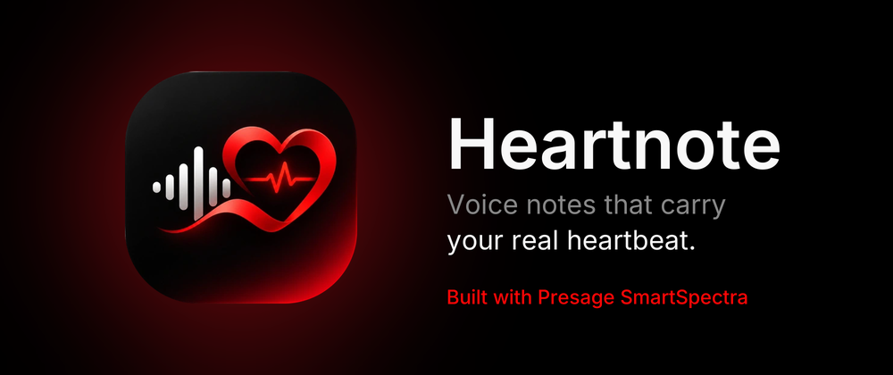

*This is a submission for the [Presage SmartSpectra SDK Challenge](https://dev.to/challenges/presage-2026-11-04)*

## What I Built

We can send a voice message to anyone, anywhere, in a second. It carries the words and the tone of voice. It doesn't carry the feeling of sitting next to someone.

People already try to keep that feeling. There are heartbeat keepsakes, recordings of a loved one's heartbeat, but they need special equipment and days of waiting. There are "send your heartbeat" phone apps, but they make you press a finger over the camera, so you can't talk while they measure. Your voice and your heartbeat are never captured together.

**Heartnote** captures both, at the same moment, hands-free.

You look at your phone and record a voice message. While you talk, the Presage SmartSpectra SDK reads your pulse and breathing from your face through the front camera. When someone plays the note back, three things happen on every beat you had *while you were saying those exact words*:

- **a soft heartbeat sound** plays under your voice,
- **the phone vibrates** with a lub-dub,
- **a particle sphere ripples** on screen.

And if they want to, they can switch to **Hold** mode, put the phone in their palm, and feel a particle heart beat in their hand.

It's built for the people who are far from the ones they love: grandparents recording for grandchildren, families across borders, long-distance partners. It's for messages that should feel like someone is in the room.

<!-- SCREENSHOT: Library (home) — docs/images/screens/library.png -->

## Demo

**🎬 Demo video: ADD LINK BEFORE PUBLISHING**

<!--  -->

The video shows the whole loop on a real Android phone: consent, recording with the live pulse, playback with the phone vibrating on each beat (filmed with a second camera, because vibration doesn't show on a screen recording), Hold mode, and sending the note over WhatsApp to a second phone.

<!-- SCREENSHOT: Record (live pulse + sphere) — docs/images/screens/record.png -->

## Code



Native Android: Kotlin 2.2 and Jetpack Compose, minSdk 28, targetSdk 36. Setup is in the README. In short:

1. Put your Presage API key in `local.properties` as `PRESAGE_API_KEY=...` (it's read into `BuildConfig`, never committed).
2. `./gradlew :app:installDebug`
3. Run it on a **physical phone**. The emulator has no real front camera, so SmartSpectra can't read anything there.

There's no login, no account, and no server. Install it, accept the consent screen, and record.

## How It Responds to Human Signals

Heartnote uses four live SmartSpectra signals: **the pulse waveform, pulse rate, breathing, and facial expressions**, plus face presence as a gate. Here is how each one becomes something you can see, hear or feel.

### 1. The pulse waveform becomes real, individual beats

A pulse *rate* is not enough for this idea. "72 BPM" would give a metronome, and a metronome isn't *you*. What I wanted were the actual moments your heart beat while you said "I miss you".

SmartSpectra gives a pulse waveform (the cardio `arterialPressureTrace`, ~30 samples a second) alongside the pulse rate. Heartnote turns that waveform into individual beat times:

1. resample to an even 30 Hz and remove the slow drift,
2. find peaks at least 333 ms apart, with a prominence threshold relative to the recent signal,
3. drop the **secondary waves**: each heartbeat has a smaller second bump, and early versions counted it as a second beat,
4. check the result against the SDK's own pulse rate, and fill short gaps from that rate.

On a 60-second test recording this found **85 beats (84.6 BPM)**, against the SDK's mean pulse rate of **83.7 BPM** for the same minute. Those beat times are what the heartbeat sound, the vibration and the particles follow.

### 2. Live while you speak, and honest about the delay

While you record, a 2,400-point particle sphere ripples on each of your detected beats, and the breathing curve makes it slowly swell and settle. The pulse number in its centre is a 5-sample median of the live pulse rate, so it doesn't jump around.

One thing surprised me in the first day's spike: the waveform samples arrive about **1.5 seconds** after the moment they describe, and pulse-rate samples about **2 seconds** after. I could have faked it, making the sphere beat "now" at the average rate. Instead the sphere plays your real beats on a fixed **1.8 s delay**. It's slightly behind, but every ripple is a beat you actually had. For the same reason, when you tap Stop the app keeps the SDK running for 2.5 more seconds to collect the last beats of your sentence.

### 3. Breathing, expressions and face presence

- **Breathing** draws a live waveform under the sphere and drives its slow swell.
- **Expressions:** moments where the `HAPPY` expression stays high become small smile markers on the playback timeline, so the listener can see where you smiled.
- **Face presence** gates recording: there's no Start without a face in view. If your face leaves the frame mid-note, the screen asks you to come back.

### 4. Playback: sound, touch and light, on the same beat

The heartbeat sound is **synthesized**, not recorded: a lub-dub is placed at each measured beat time and mixed under your voice. I normalise the voice to a fixed loudness and keep the heartbeat at a fixed peak, so a quiet speaker and a loud one end up feeling the same. Playback polls the player position every 10 ms and fires each beat's vibration and particle ripple at its timestamp.

The app labels this honestly: under the player it says **"Timed to your measured pulse"**. After recording it shows no pulse numbers at all. The point is the rhythm, not a reading.

<!-- SCREENSHOT: Playback (dot chart filling, smile marker) — docs/images/screens/playback.png -->
<!-- SCREENSHOT: Hold (particle heart) — docs/images/screens/hold.png -->

### 5. Sharing: the heartbeat has to survive WhatsApp

A heartbeat you can only feel on your own phone isn't much of a message. So Heartnote shares a note as an ordinary file that plays anywhere: a **video** (`.mp4`) with the animated sphere, or **audio** (`.m4a`). Both carry a small hidden data track with the beat timing, so when the file is opened in Heartnote on the other phone, the vibration plays again.

Then I sent one through WhatsApp, and the hidden track was gone: WhatsApp re-encodes media and drops anything it doesn't recognise. Two fixes:

- **Save to phone.** Heartnote can save the file to `Downloads/Heartnote` and shows the exact steps to send it on WhatsApp as a *Document*, which arrives byte-for-byte intact.
- **Beat recovery.** If the data track is missing, the heartbeat is still *in the sound*. Heartnote decodes the audio, keeps only the low band where the heartbeat lives (40–100 Hz, below most of the voice), and matches it against the known lub shape to find every beat again. On my test set, including a loud, deep voice over a quiet heartbeat, it recovered **100% of beats within ±60 ms**.

The video is rendered on the phone with Android's hardware H.264 encoder. Each frame is drawn from the note's beat times, so the same note always produces the same video.

<!-- SCREENSHOT: Share sheet — docs/images/screens/share.png -->

### What testing on a real phone taught me

The parts that took longest weren't in any plan:

- **Emissions are split by type.** Face, cardio and breathing data arrive as *separate* metrics messages. "Is there a face?" has to be "did a face message arrive recently?", not "does this message have a face?"
- **My first real recording was silent.** The microphone produced a file of perfect zeros, because another app held the mic. Heartnote now checks the audio level two seconds in and tells you instead of saving a silent note.
- **Double beats.** Secondary waves can be half of all peak candidates, so comparing against the *median* peak height doesn't remove them. Comparing against the 80th percentile does.
- **The encoder failed on large buffers.** Android's AAC encoder rejected oversized input, so audio is now fed one 1,024-sample frame at a time.
- **Hands-free recording hit the screen timeout.** Nobody touches the screen while talking, so the phone locked mid-note. The Record screen now keeps the screen on. I also cap the particle sphere at 30 fps while measuring, so it doesn't compete with SmartSpectra for the phone's processor. With Battery saver on, or on a warm phone, Heartnote tells you up front that the camera may be slow.

### What I'm not claiming

Heartnote is not a medical device and makes no claims about your body. The heartbeat you hear is a synthesized sound placed at your measured beat times, not a recording of your heart. The video is a visualisation, not a scan.

## Prize Categories

I'm entering **both**.

**Most Creative or Delightful Use.** Most camera-signal apps show you a number about yourself. Heartnote turns the signal into a gift for someone else: a heartbeat you can *feel* in your hand, captured from a face while it talks, and sent as an ordinary voice note. The delight is in the small moment of holding a phone that beats with someone you love.

**Best Thoughtful Real-World Use.** The need is real and old: people want to keep and share the presence of the people they love, especially across distance. Heartnote does it with nothing but a phone. There's no wearable, no account and no server, and it fits into the messaging apps people already use. It's designed for non-technical users: one Record button, a short optional tour that uses only made-up data, three vibration strengths, and reduced-motion support. The privacy choices below are built in, not bolted on.

## Consent and Data Handling

- **Consent first.** On first launch, a consent screen explains in plain words what the camera reads and what is stored. Camera and microphone permissions are requested only after you tap "I understand". Before *every* recording you confirm "I am recording myself", and recording can't start without a face in view.
- **No video is stored.** Camera frames are never saved or written anywhere (the SDK's image output is turned off). The camera feed is used live and discarded.
- **Stored on your phone only:** your voice audio, the mixed note, beat times, the breathing curve, pulse-rate samples and smile segments. App data is excluded from cloud backup and device transfer.
- **Sharing is always your action.** Only the file you choose is shared, and only through the app you pick. Shared files contain your voice, the heartbeat sound and the beat timing needed to replay the vibration. They contain **no raw camera-derived signals**: no pulse waveform, no pulse-rate samples, no breathing, no expressions. The share sheet says so before you send.
- **Receiving is never automatic.** A received note is imported only when you open it with Heartnote, and it stays on your phone.
- **Retention and deletion.** Notes stay until you delete them. Delete removes every file of that note, and uninstalling removes everything. Files you saved to Downloads are yours and stay until you remove them.
- **No Heartnote servers.** There are no accounts, no analytics and no crash reporting. Heartnote itself sends nothing anywhere.
- **SDK network use and telemetry.** The SmartSpectra SDK uses the internet to validate the Presage API key. It has a telemetry setting (`enableTelemetry`), which Heartnote leaves at the SDK's default. What the SDK sends is covered by Presage's own privacy policy ([presagetech.com](https://presagetech.com/)), and the app's privacy screen says so.
- **No AI services.** Heartnote uses no optional AI or cloud services.

## Thanks

To Presage for an SDK that made "read my pulse while I talk" possible on an ordinary phone, and to the DEV team for running this challenge.

Credits: Presage SmartSpectra SDK · Inter font (SIL Open Font License) · Lucide icons (ISC).

---

**Heartnote. Don't just hear the moment. Feel it.** ❤️
