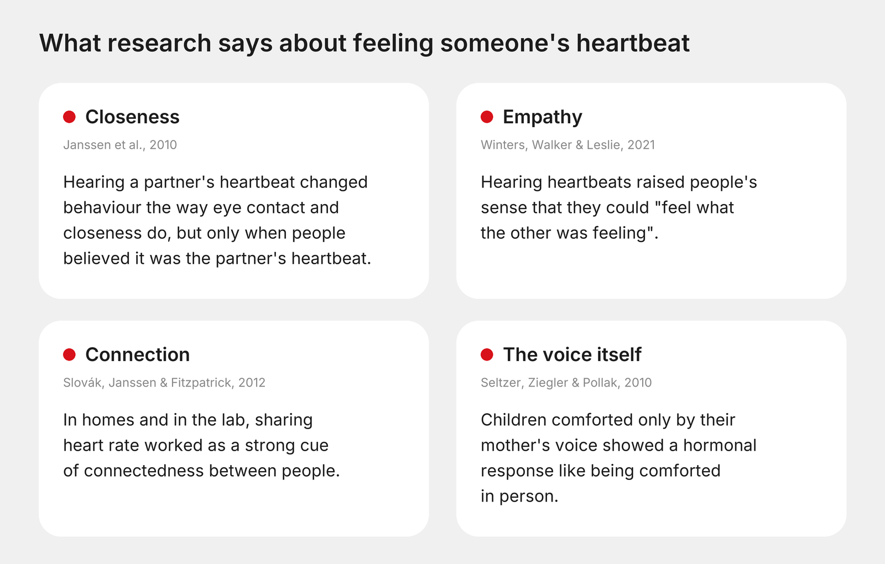
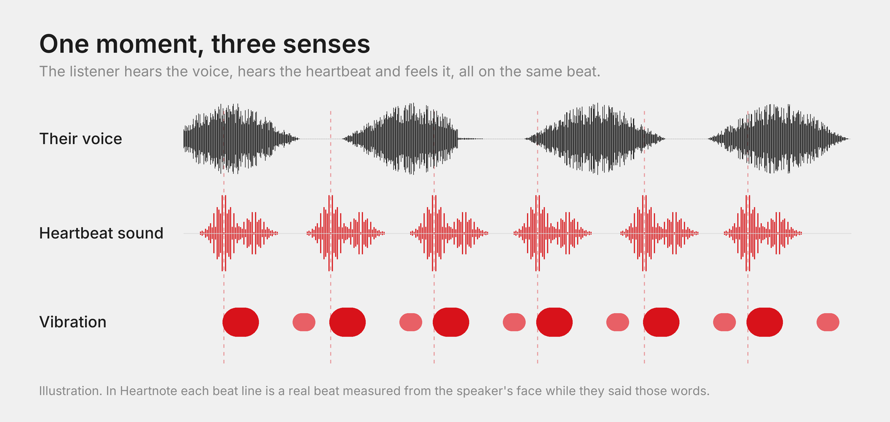
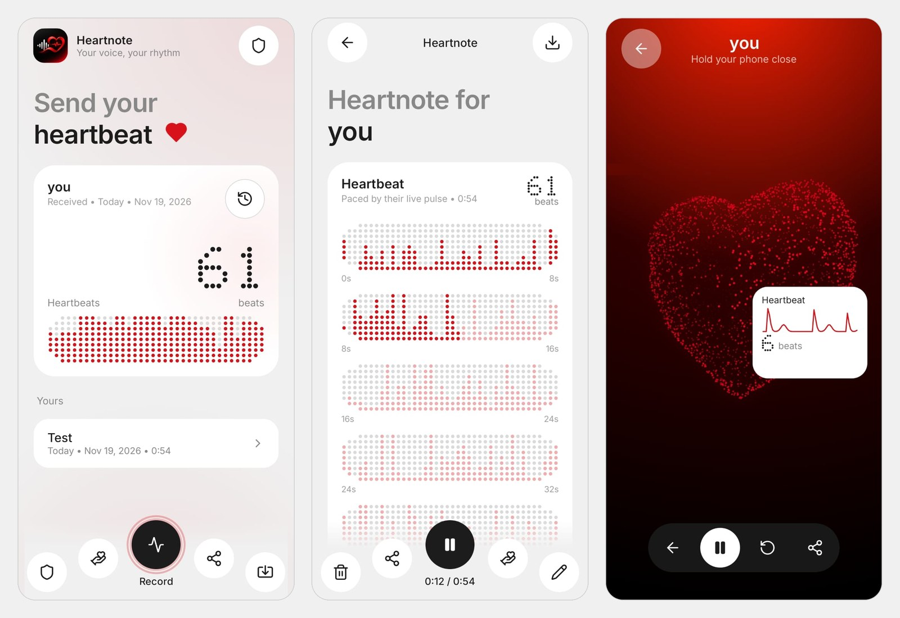
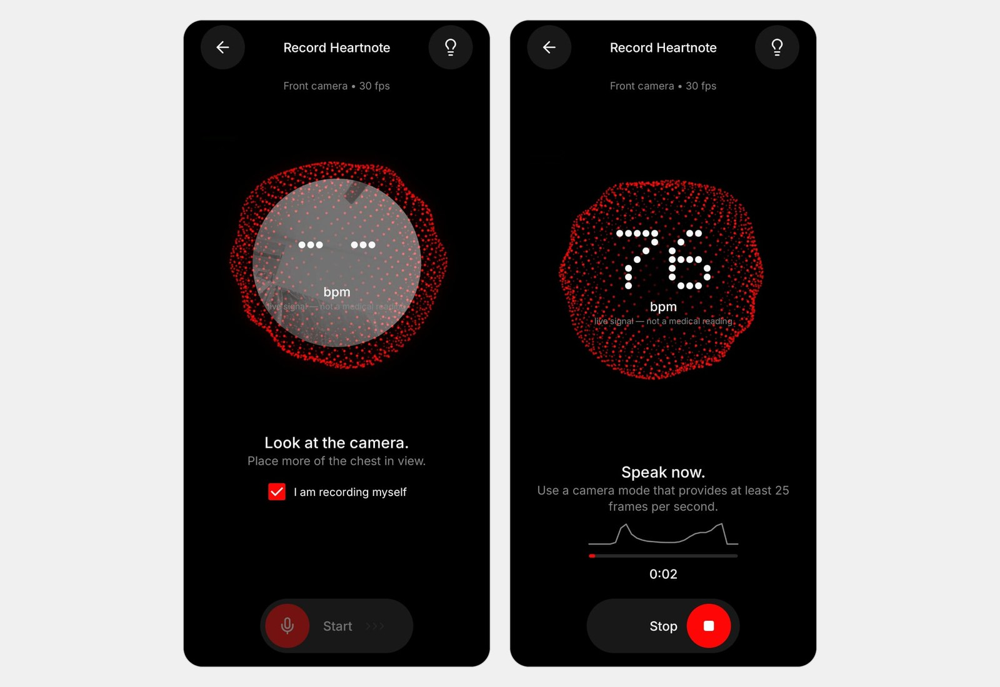
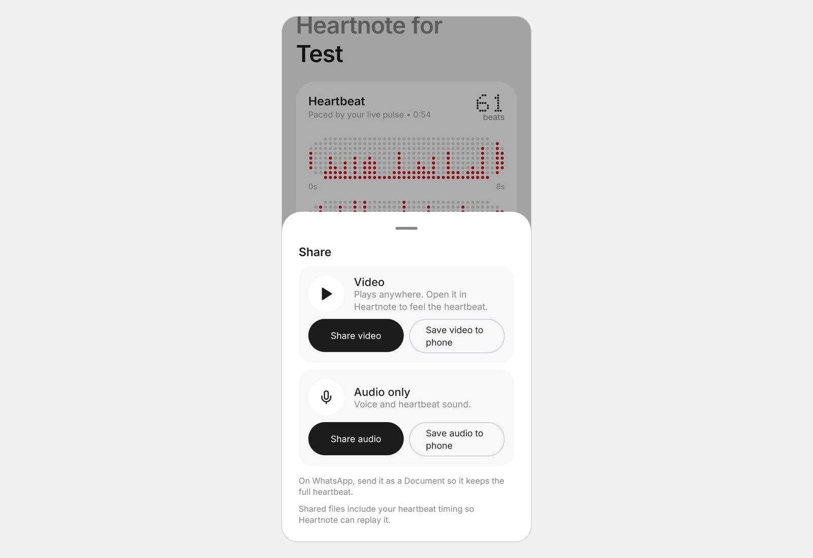

*This is a submission for the [Presage SmartSpectra SDK Challenge](https://dev.to/challenges/presage-2026-11-04)*


> We can send voice messages to anyone, anywhere. But there's one thing they can't carry: the feeling of being close to someone.
> A voice can tell you how someone feels. But what if you could actually *feel* them?

**📲 [Download the Heartnote APK](https://drive.google.com/drive/folders/1y-YCHGZBaAIKrFBRwdPCQALGZdgDndiz?usp=sharing)** · **🎬 [Watch the 2-minute demo](https://youtu.be/fdZyFwfX9mY)** · **💻 [Source on GitHub](https://github.com/Dronzer2code/HeartNote)**

## What I Built

**Heartnote** is an Android app for voice notes you can feel.

You look at your phone and record a message. While you talk, the **Presage SmartSpectra SDK** reads your pulse and breathing from your face through the front camera. There's no finger on the lens and nothing to wear. When someone plays your note, on every beat you had *while you were saying those exact words*:

- 🔊 a soft heartbeat sound plays under your voice,
- 📳 the phone vibrates with a lub-dub,
- ✨ the screen ripples with particles.

Then they can tap **Hold**, put the phone in their palm, and feel a heart beat in their hand.

### Why feeling a heartbeat changes how a voice lands

Think of the last time you fell asleep on someone's chest. You didn't hear the words they said. You heard *thump, thump, thump*, slow and steady under your ear, and that told you everything: *I'm here. You're safe. I'm not going anywhere.*

A heartbeat is the oldest sound any of us know. We heard one for nine months before we ever heard a word. It's the sound of someone being alive, right next to you. And it's the one thing a voice message has always left behind.

A voice note carries *what* someone said. It doesn't carry the body that said it: the heart that sped up on "I'm so proud of you", or the slow, calm rhythm of a grandmother saying goodnight. Heartnote puts that body back into the message, as sound **and** as touch, timed to the exact words.

This isn't just a nice idea. It's what research on heartbeats and connection keeps finding:



- **A heartbeat is a cue of closeness.** In two studies, Janssen and colleagues found that hearing a conversation partner's heartbeat changed people's behaviour the way eye contact and physical closeness do. But there was a catch: it only worked when people believed the heartbeat *belonged to the partner*. A generic heartbeat sound did nothing. ([Janssen et al., 2010](https://vhil.stanford.edu/publications/avatars-and-agents/intimate-heartbeats-opportunities-affective-communication)) The researchers also suggested the same feeling could travel as touch, through something like a vibrating ring. ([ScienceDaily summary](https://sciencedaily.com/releases/2011/04/110407093118.htm))
- **Hearing a heartbeat builds empathy.** At CHI 2021, Winters, Walker and Leslie found that hearing heartbeats increased people's reported ability to "feel what the other was feeling". ([Winters et al., 2021](https://microsoft.com/en-us/research/?p=815314))
- **Sharing heart rate feels like connection.** In lab studies and a two-week trial in people's homes, Slovák, Janssen and Fitzpatrick found heart-rate sharing worked as a strong connectedness cue. Their participants experienced it both as information and as *connection*. ([Slovák et al., CHI 2012](https://core.ac.uk/download/83920447.pdf))
- **And the voice already matters more than we think.** Seltzer, Ziegler and Pollak found that children comforted *only by their mother's voice* showed a hormonal response like the one from being comforted in person. They concluded that the voice may matter about as much as touch for human bonding. ([Seltzer et al., 2010](https://pmc.ncbi.nlm.nih.gov/articles/PMC2982050))

Put those together and you get Heartnote's core design rule: **the heartbeat has to be real, and it has to be theirs.** A looping heartbeat sound would be a sound effect. Janssen's work suggests people feel the difference. So every beat in a Heartnote is a beat SmartSpectra measured from the speaker's face *while they were saying those words*, and the app tells the listener whether the beats were timed from the waveform or paced from the live pulse.



Voice, heartbeat sound and vibration arrive together. You hear "I miss you", and at the same moment you hear and *feel* the heart of the person who said it.

I want to be honest about the limits. These studies looked at heartbeats in labs, conversations and homes. Not one of them tested a voice note like this, and no one has measured Heartnote's effect yet. Reviews of remote touch make the same point: its benefits are often assumed rather than tested ([Haans & IJsselsteijn, 2006](https://link.springer.com/doi/10.1007/s10055-005-0014-2)). A proper study with families who live apart is the next thing I want to run. What the research does say clearly is where to look: a *real* heartbeat, *attributed* to the person you love, is one of the most intimate signals a human body can send.

Heartnote makes no health or medical claims. It's about closeness, not measurement.


*Home, a note playing (its dot chart fills as it plays, one red column per beat), and Hold mode.*

### Why this, and why a camera

People have always tried to keep the presence of the people they love. Heartbeat keepsakes exist, but they need special equipment and days of waiting. "Send your heartbeat" phone apps exist too, but you press a finger over the camera to measure, so you can't talk at the same time. **Your voice and your heartbeat are never captured together.**

SmartSpectra is what makes this possible. It reads the signal from your face, so your hands stay free and your mouth stays free to talk. For the first time, the words and the heartbeat behind them can be recorded in the same moment.

Heartnote is for people who live far from the people they love: grandparents recording for grandchildren, families across borders, long-distance partners. It's for messages that should feel like someone is in the room.

## Demo



The video shows the whole loop on a real phone: consent, recording with the live pulse, playback with the phone vibrating on each beat (filmed with a second camera, since vibration doesn't show on a screen recording), Hold mode, and sharing.

## Code

**Repository:** [github.com/Dronzer2code/HeartNote](https://github.com/Dronzer2code/HeartNote)

Native Android: Kotlin 2.2, Jetpack Compose, minSdk 28, targetSdk 36. The README has full setup. In short:

1. Add your Presage key to `local.properties` as `PRESAGE_API_KEY=...`. Gradle reads it into `BuildConfig`, and it's never committed.
2. `./gradlew :app:installDebug`
3. Run it on a **physical phone**. The emulator has no real front camera for SmartSpectra to read.

**Just want to try it?** [Download the APK](https://drive.google.com/drive/folders/1y-YCHGZBaAIKrFBRwdPCQALGZdgDndiz?usp=sharing) and install it on an Android phone running Android 9 or newer. You may need to allow "Install unknown apps" for your browser or Files app. There's no login, no account and no server, so judges can install it and record straight away.

## How It Responds to Human Signals

Heartnote uses **four live SmartSpectra signals: the pulse waveform, pulse rate, breathing and facial expressions**, plus face presence as a gate. The whole integration starts in `Application.onCreate`:

```kotlin
val sdk = SmartSpectraSdk.shared
sdk.config.apiKey = BuildConfig.PRESAGE_API_KEY
// Camera frames must never be exposed or written to disk
sdk.config.imageOutputEnabled = false
sdk.config.requestedMetrics =
    SmartSpectraConfig.breathingMetrics +
        SmartSpectraConfig.cardioMetrics +
        listOf(MetricType.EXPRESSIONS, MetricType.TALKING)
sdk.useCamera(CameraSelection.Front)
```

The Record screen then collects `sdk.metricsFlow`, while `processingStatus`, `validationStatus` and `error` drive the on-screen guidance.


*Left: before recording. The camera shows inside the sphere, and you confirm you're recording yourself. Right: recording. The pulse is live, the breathing curve moves, and the sphere ripples on your beats.*

### 1. The pulse waveform becomes your real beats

A pulse *rate* wasn't enough for this idea. "72 BPM" gives you a metronome, and a metronome isn't *you*. I wanted the actual moments your heart beat while you said "I miss you".

So Heartnote turns SmartSpectra's cardio waveform (`arterialPressureTrace`, about 30 samples a second) into individual beat times:

1. **Resample** to an even 30 Hz and remove slow drift.
2. **Find peaks** at least 333 ms apart, with a prominence threshold relative to the recent signal.
3. **Drop the secondary bumps.** Every heartbeat has a smaller second wave, and early versions counted it as another beat. Comparing peaks to the *median* height didn't work, because secondary waves can be half of all candidates. Comparing them to the **80th percentile** does.
4. **Check against the SDK's pulse rate** and fill short gaps from it.

On a 60-second test recording this found **85 beats (84.6 BPM)**. The SDK's mean pulse rate for the same minute was **83.7 BPM**.

When the waveform isn't clean enough, for example in dim light or with lots of movement, the rate check fails. Heartnote then falls back to beats **paced by your live pulse rate**. It tells the listener which one they're hearing: every note is labelled either **"Timed to your measured pulse"** or **"Paced by your live pulse"**. The note in the screenshots above is a paced one, and the app says so.

### 2. Live while you speak, and honest about the delay

While you record, a 2,400-point particle sphere ripples on your detected beats, and your breathing makes it slowly swell and settle. The big dot-matrix number is a 5-sample median of the live pulse rate, so it doesn't jitter.

On day one I logged raw `metricsFlow` emissions to find out how the SDK behaves. Two findings shaped the design:

- **Signals arrive late.** Waveform samples arrive about **1.5 s** after the moment they describe, and pulse-rate samples about **2 s** after. I could have faked "real time" by making the sphere beat at the average rate. Instead it plays your *real* beats on a fixed **1.8 s delay**: slightly behind, but every ripple is a beat you actually had. For the same reason, after you tap Stop the SDK keeps running for **2.5 s** to catch the last beats of your sentence.
- **Emissions are split by type.** Face, cardio and breathing data come in separate `Metrics` messages. So "is there a face?" really means "did a face message arrive recently?", not "does this message contain a face?"

### 3. Breathing, expressions and face presence

- **Breathing** draws the live curve under the sphere and drives its slow swell.
- **Expressions:** moments where `HAPPY` stays high become smile markers on the playback timeline, so the listener can see where you smiled.
- **Face presence** gates the whole flow: Start doesn't work without a face in view. If you drift out of frame mid-sentence, the screen says "Keep your face in view of the camera". If you're gone for 8 seconds, a note that already has 10 seconds of you in it is saved, not lost.

### 4. Playback: sound, touch and light on the same beat

The heartbeat sound is **synthesized**: a lub-dub is placed at each beat time and mixed under your voice. The voice is normalised to a fixed loudness and the heartbeat to a fixed peak, so a whisper and a loud voice feel the same. Playback polls the player position every 10 ms and fires each beat's vibration and particle ripple right on time. Vibration has Soft, Medium and Strong settings, because phone motors vary a lot.

### 5. Sharing: the heartbeat has to survive WhatsApp

A heartbeat you can only feel on your own phone isn't much of a message. Heartnote shares a note as a normal file that plays anywhere: a **video** (`.mp4`, with the animated sphere) or **audio** (`.m4a`). Both carry a small hidden data track with the beat timing. Open the file in Heartnote and the beats come back with it. The **"Received"** note on the home screen above came back this way, with all **61 beats** intact.


*One share sheet for every entry point, with Save to phone and the WhatsApp tip.*

Then I sent one through WhatsApp as normal media, and the hidden track was gone, because WhatsApp re-encodes media. Two fixes:

- **Save to phone, send as a Document.** Heartnote saves the file to `Downloads/Heartnote` and shows the exact WhatsApp steps (Attach → Document). Files sent that way arrive byte-for-byte.
- **Beat recovery from the sound itself.** Even when the data track is stripped, the heartbeat is still *in the audio*. Heartnote decodes it, keeps only the 40–100 Hz band where the heartbeat sits below most of a voice, and matches it against the known lub shape to find each beat again. On my test set, including a loud, deep voice over a quiet heartbeat, it recovered **100% of beats within ±60 ms**.

The video is rendered on the phone with the hardware H.264 encoder. Every frame is drawn from the note's beat times, so the same note always produces the same video.

### What a real phone taught me

The hardest parts weren't in any plan:

- **My first real recording was silent.** Another app held the microphone, and I got a file of perfect zeros. Heartnote now checks the level two seconds in and tells you, instead of saving a silent note.
- **The audio encoder choked on big buffers,** so audio is now fed in 1,024-sample frames.
- **Hands-free means nobody touches the screen,** so the phone locked mid-note and the recording ended. The Record screen now keeps the screen on.
- **The sphere competed with SmartSpectra for the processor.** While measuring, the sphere is capped at 30 fps and its blur is turned off. If Battery saver is on or the phone is warm, Heartnote warns you that the camera may run slowly.

### What I'm not claiming

Heartnote is not a medical device and makes no claims about your body. The heartbeat you hear is a synthesized sound placed at your beat times, not a recording of your heart. After recording, the app shows no pulse numbers at all. The point is the rhythm, not a reading.

## Prize Categories

I'm entering **both**.

**Most Creative or Delightful Use.** Most camera-signal apps show you a number about yourself. Heartnote turns the signal into **a gift for someone else**: a heartbeat captured from a face while it talks, sent as an ordinary voice note, and felt in someone else's hand. The delight is small and physical: a phone that beats like the person who sent it.

**Best Thoughtful Real-World Use.** The need is old and universal: keeping close to people who are far away. Heartnote meets it with only the phone people already own, inside the messaging apps they already use, with no wearable, account or server. It's built for non-technical people:
- one Record button,
- a 30-second optional tour that uses only made-up data,
- three vibration strengths,
- reduced-motion support,
- plain-language status lines ("Look at the camera.", "Speak now.").

The privacy design below was part of the plan from day one.

## Consent and Data Handling

- **Consent first.** On first launch, a consent screen explains in plain words what the camera reads and what's stored. Camera and microphone permissions are requested only after you tap "I understand". Before *every* recording you tick **"I am recording myself"**, and recording can't start without a face in view. Heartnote can't be used to record someone covertly.
- **No video is stored.** Camera frames are never saved or written anywhere. The SDK's image output is off (`imageOutputEnabled = false`), and the camera feed is used live and discarded.
- **Stored on your phone only:** your voice audio, the mixed note, beat times, the breathing curve, pulse-rate samples and smile segments. App data is excluded from cloud backup and device transfer.
- **Sharing is always your action.** Only the file you choose is shared, through the app you pick. Shared files contain your voice, the heartbeat sound and the beat timing needed to replay it. They contain **no raw camera-derived signals**: no pulse waveform, no pulse-rate samples, no breathing, no expressions. The share sheet says this before you send.
- **Receiving is never automatic.** A note is imported only when you open it with Heartnote, and it's stored only on your phone.
- **Retention and deletion.** Notes stay until you delete them. Delete removes every file of a note, and uninstalling removes everything. Copies you saved to Downloads are yours to keep or remove.
- **No Heartnote servers.** There are no accounts, no analytics and no crash reporting. Heartnote itself sends nothing anywhere.
- **SDK network use and telemetry.** SmartSpectra uses the internet to validate the Presage API key. It also has a telemetry setting (`enableTelemetry`), which Heartnote leaves at the SDK's default. What the SDK sends is covered by Presage's own privacy policy ([presagetech.com](https://presagetech.com/)), and the app's privacy screen says so.
- **No AI services.** Heartnote uses no optional AI or cloud services.

## Thanks

Thank you to Presage for an SDK that makes "read my pulse while I talk" possible on an ordinary phone, and to the DEV team for running this challenge.

Credits: Presage SmartSpectra SDK · Inter (SIL Open Font License) · Lucide icons (ISC).

---

**Heartnote. Don't just hear the moment. Feel it.** ❤️
