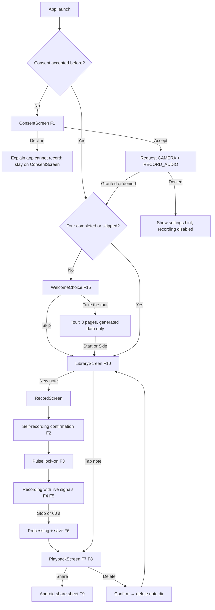
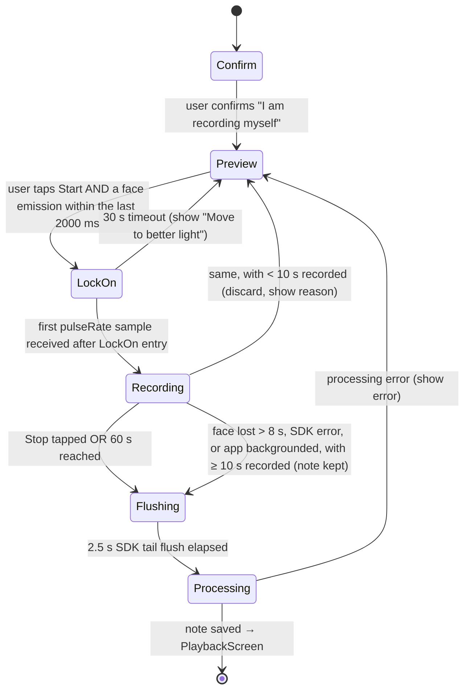
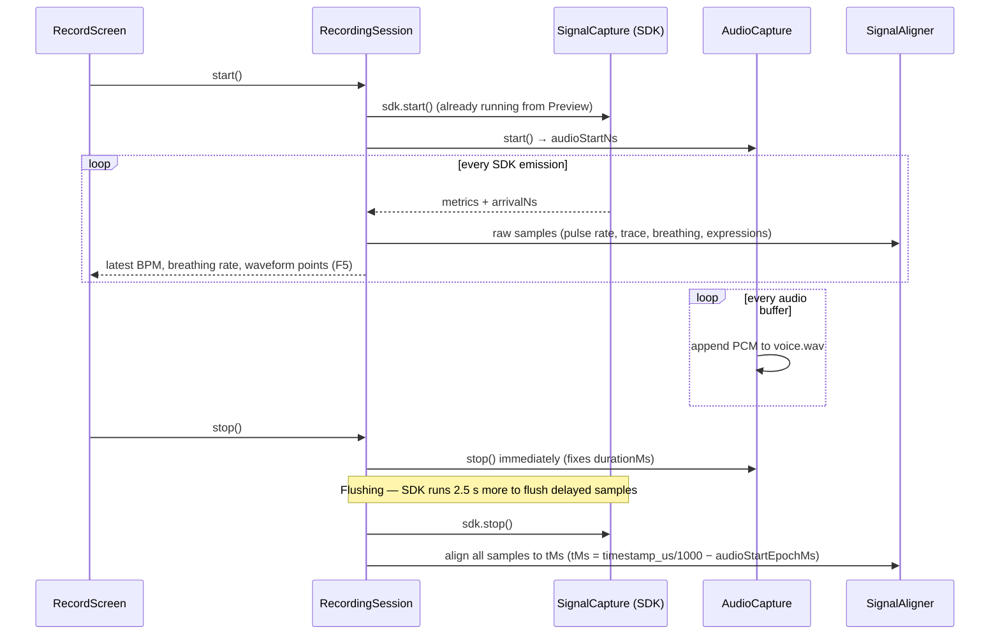
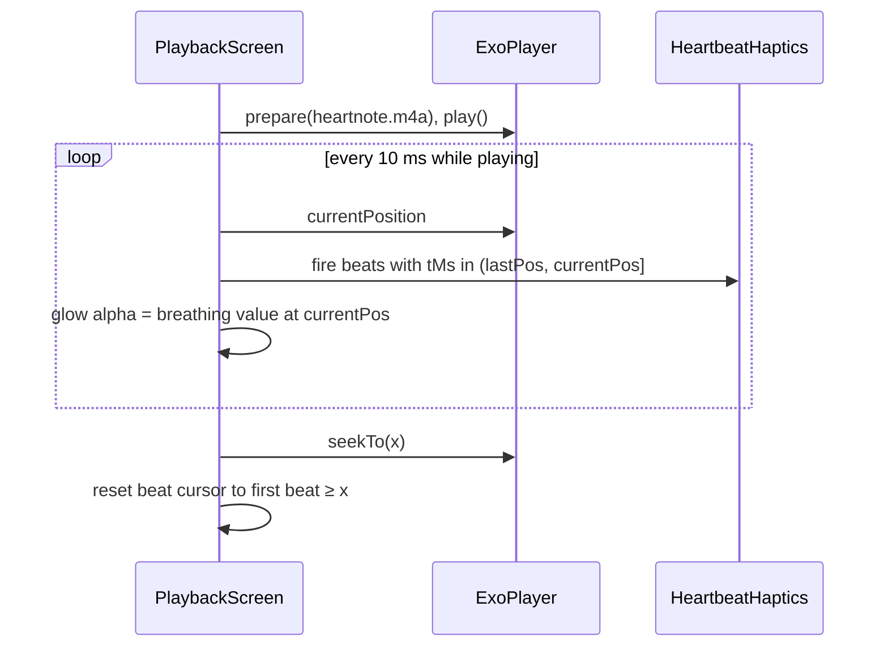
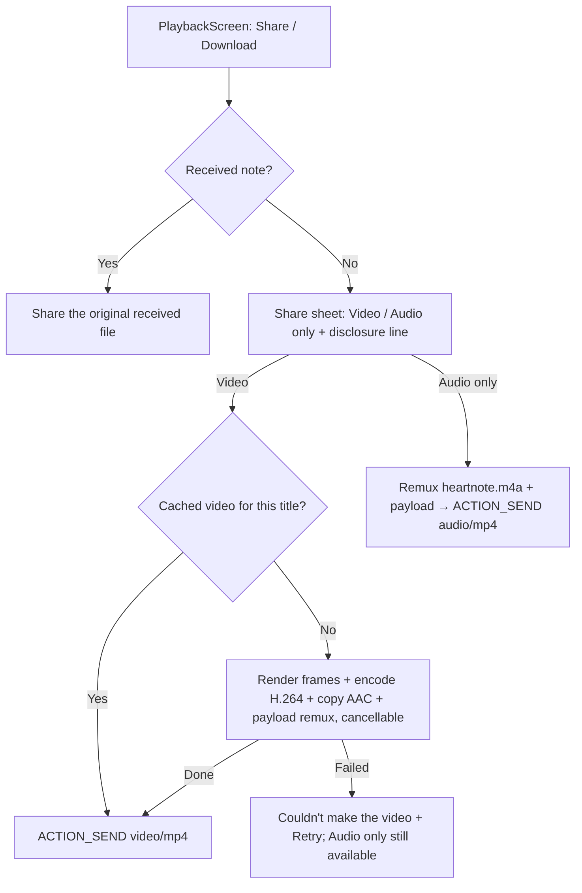
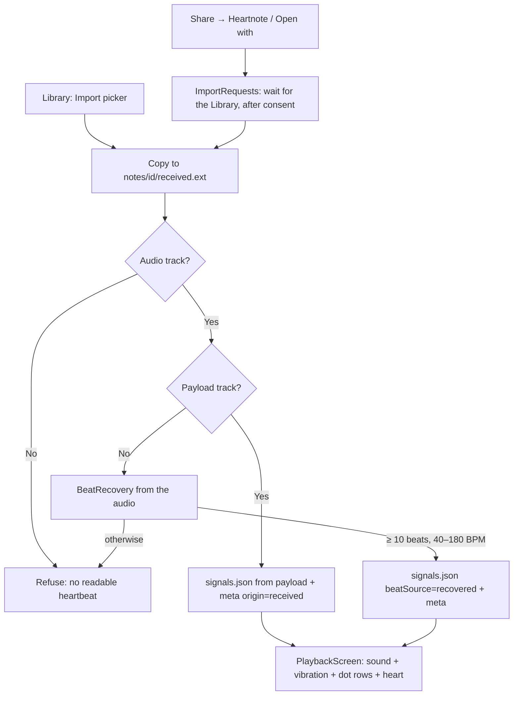

# PROCESS_FLOW.md — Heartnote

## PURPOSE

Defines how Heartnote works at runtime: the user journey, the recording pipeline, the playback pipeline, and the data lifecycle.
Feature IDs (F*) and constraints (C*) are defined in `PRD.md`. Component names match `TRD.md` § PROJECT STRUCTURE.

## USER JOURNEY

## RECORD SCREEN STATE MACHINE

Rules:
- Audio capture starts on entering `Recording`, not during `LockOn` (lock-on silence is not part of the note).
- Audio capture stops IMMEDIATELY on entering `Flushing` (this fixes `durationMs`). The SDK keeps running for 2.5 s to flush delayed samples (measured medians: bpTrace 1.5 s, pulseRate 2.0 s behind wall clock), then `sdk.stop()`. UI during `Flushing`: "Finishing your heartbeat…".
- Metrics emissions are split by type (face, cardio, breathing arrive as separate messages), so "face present" = a face-bearing emission within the last 2000 ms (was 1000 ms; widened 2026-11-19 because a slow camera spaces face emissions out). While recording with no face, the status line says "Keep your face in view of the camera."
- The screen is kept on for the whole Record screen (`view.keepScreenOn`); otherwise the screen timeout backgrounds the app mid-note.
- The SDK runs from `Preview` through `Flushing`. `sdk.stop()` is called on leaving `Flushing` or when the screen stops.
- `sdk.processingStatus == ERROR` from any state → show `sdk.error`, return to `Preview`.

## RECORDING PIPELINE

## PROCESSING PIPELINE (F6)

Runs on `Dispatchers.Default` after `Recording` ends. Order is fixed:

1. `SignalAligner` → aligned samples in `tMs`.
2. `BeatExtractor` → `beatsMs`, `beatSource`.
3. `SmileDetector` → `smiles` (F8; skipped if cut).
4. Write `signals.json`, `meta.json`.
5. `HeartbeatSynth` → heartbeat PCM for `durationMs`.
6. `Mixer` → mixed PCM (voice + heartbeat).
7. `AacExporter` → `heartnote.m4a`.
8. ~~Delete `voice.wav`~~ — since 2026-11-18 `voice.wav` is kept so notes can be re-mixed (SHARE_AND_IMPORT.md).
9. Navigate to `PlaybackScreen(id)`.

Failure at any step: keep `voice.wav` and `signals.json` if written, show "Could not finish this note" with Retry (re-runs from step 5) and Delete.

## PLAYBACK PIPELINE (F7)

- Heartbeat sound is already inside `heartnote.m4a`; haptics are the only runtime-synchronized output.
- Smile markers (F8) are drawn on the seek bar from `smiles`.
- No pulse numbers are displayed during playback (C1).

## SHARE FLOW (F9, original — superseded by the 2026-11-18 share flow below)

1. User taps Share on `PlaybackScreen`.
2. `ShareHelper` creates a content URI for `notes/<id>/heartnote.m4a` via `FileProvider`.
3. `Intent.ACTION_SEND`, `type = "audio/mp4"`, read-URI permission granted.
4. The recipient receives a standard audio file. Haptics and breath glow are only available inside Heartnote — since 2026-11-18 the file carries a payload, so a recipient who imports it into Heartnote gets them too (F14).

## SHARE FLOW (F9 revised, F13) — 2026-11-18

## IMPORT FLOW (F14)

## DATA LIFECYCLE

| Data | Created | Location | Leaves device? | Removed |
|---|---|---|---|---|
| Camera frames | During Preview/LockOn/Recording | SDK memory only | SDK behaviour UNKNOWN (see `TRD.md` § CONSENT AND DATA HANDLING) | Never written to disk |
| `voice.wav` | Recording | `filesDir/notes/<id>/` | No | On Delete / uninstall (kept for re-mixing) |
| `share/*.m4a`, `share/*.mp4` | When the user shares | `filesDir/notes/<id>/share/` | Only via user-initiated Share (voice, heartbeat sound, beat timing; no raw signals) | Rebuilt on rename; on Delete / uninstall |
| `received.<ext>` | Import | `filesDir/notes/<id>/` | No (re-share only on user action) | On Delete / uninstall |
| `signals.json`, `meta.json` | Processing | `filesDir/notes/<id>/` | No | On Delete / uninstall |
| `heartnote.m4a` | Processing | `filesDir/notes/<id>/` | Only via user-initiated Share | On Delete / uninstall (shared copies are outside app control) |

## RELATED DOCUMENTS

- `PRD.md` — features and constraints referenced above.
- `TRD.md` — component internals, algorithms, unresolved spike questions.
- `MVP.md` — which flows are required before the deadline.
